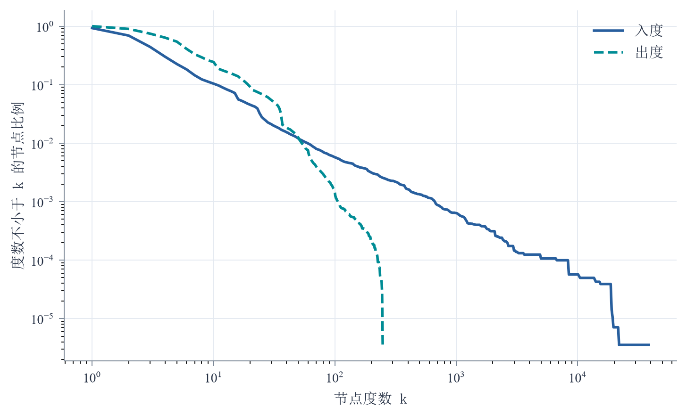
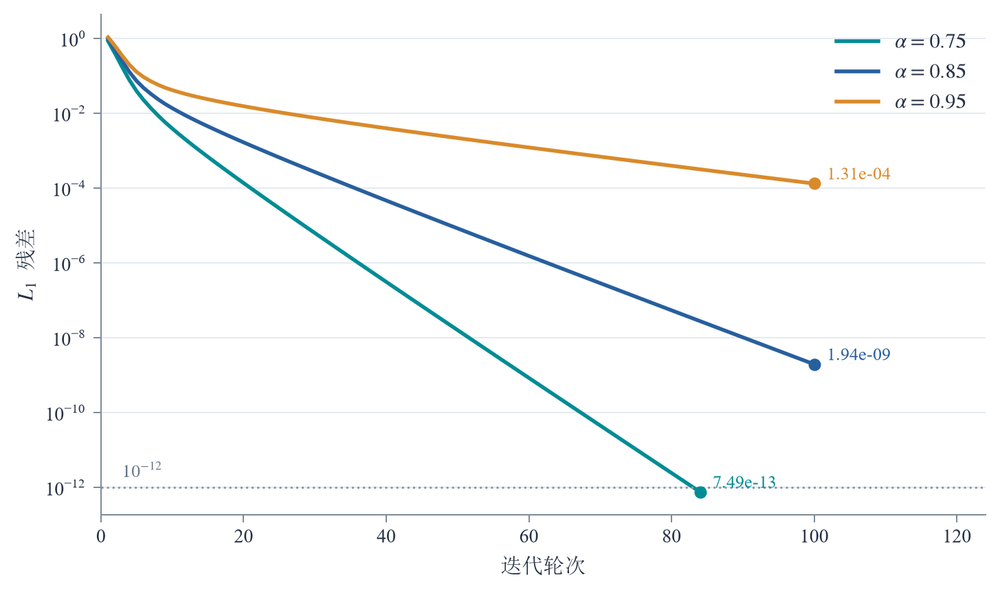
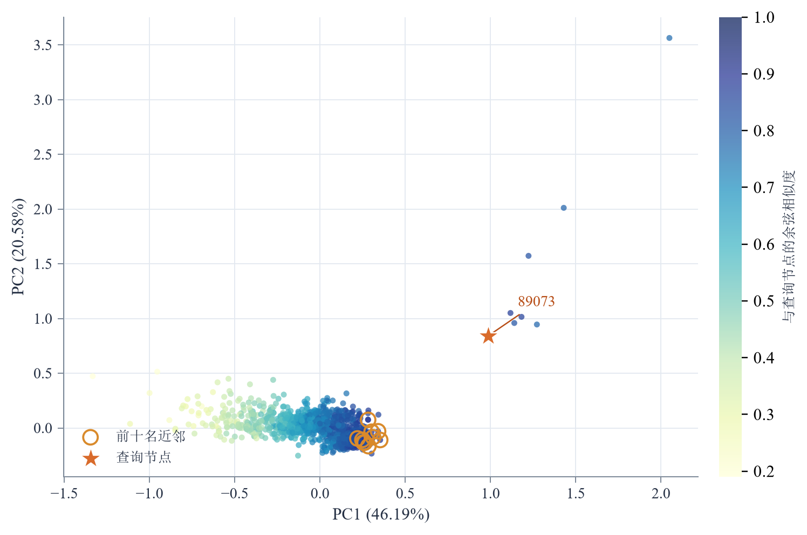
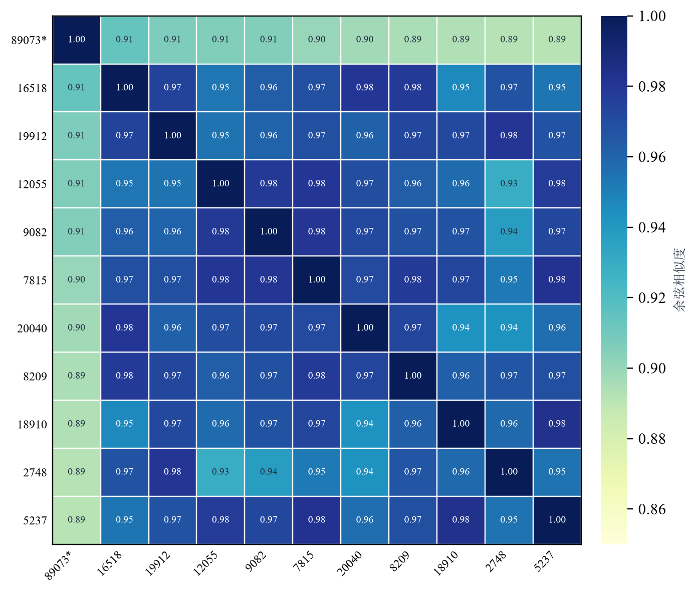

# 作业2：TuGraph 网页链接图分析


- [在线阅读全文：实验过程、算法与结果](REPORT.md)
- [查看实验报告 PDF](output/pdf/作业报告.pdf)
- [查看 LaTeX 源文件](latex_report/main.tex)
- [查看算法代码](scripts/run_experiment.py)
- [查看完整结果记录](results/experiment_summary.json)

## 实验内容

报告共 19 页。使用 SNAP Stanford Web Graph，在 TuGraph 中构建网页与有向超链接图。完成数据导入、图规模核验和图数据导出，再基于导出图运行 PageRank 与 Node2Vec。

| 项目 | 实验结果 |
| --- | ---: |
| 网页节点数 | 281,903 |
| 有向链接数 | 2,312,497 |
| PageRank 最高节点 | 89073 |
| 最高 PageRank 得分 | 0.01130285 |
| Node2Vec 样本节点 / 有向边 | 1,200 / 2,289 |
| 嵌入维数 | 32 |
| 第 1 轮 / 第 5 轮平均负采样损失 | 2.01132 / 1.85049 |

## 数据集

- [SNAP Stanford Web Graph 数据页面](https://snap.stanford.edu/data/web-Stanford.html)
- [原始压缩边列表](https://snap.stanford.edu/data/web-Stanford.txt.gz)

节点标签为 `webpage`，整数主键为 `id`；边标签为 `hyperlink`，边的方向表示网页间的超链接方向。原始数据通过下载脚本获取。

## 实验流程

1. 下载原始边列表，提取并去重端点编号，生成顶点和边 CSV。
2. 根据 `import.json` 建立 TuGraph 图模式并批量导入数据。
3. 使用 Cypher 查询核验节点数和边数，结果保存于 [tugraph_verification.json](results/tugraph_verification.json)。
4. 使用 `lgraph_export` 导出图数据，作为两项算法的输入。
5. 在全图上运行 PageRank，保存排名和运行指标。
6. 以节点 89073 为中心抽取 1,200 节点的诱导子图，训练 Node2Vec 并检索嵌入近邻。
7. 统计度分布与分值集中度，比较三组阻尼系数，并绘制嵌入投影和近邻相似度热力图。

## 运行方法

环境：Python 3.10+、Docker Desktop。实验使用 TuGraph 镜像 `tugraph/tugraph-runtime-centos7:4.5.1`。以下命令在仓库根目录的 PowerShell 中执行。

### 1. 准备数据

```powershell
git clone https://github.com/MuonChaser/tugraph-homework-2.git
cd tugraph-homework-2
python -m pip install -r requirements.txt
python scripts/download_data.py
python scripts/run_experiment.py prepare
docker pull tugraph/tugraph-runtime-centos7:4.5.1
```

### 2. 导入 TuGraph

```powershell
docker run --rm -v "$($PWD.Path):/workspace" tugraph/tugraph-runtime-centos7:4.5.1 `
  lgraph_import -c /workspace/import.json --dir /workspace/tugraph_db `
  --graph default --overwrite 1
```

### 3. 导出图数据

将 TuGraph 管理员密码传入环境变量：

```powershell
$env:TUGRAPH_PASSWORD = Read-Host "TuGraph 管理员密码"
docker run --rm -v "$($PWD.Path):/workspace" tugraph/tugraph-runtime-centos7:4.5.1 `
  lgraph_export -d /workspace/tugraph_db -e /workspace/tugraph_export `
  -g default -f csv -u admin -p "$env:TUGRAPH_PASSWORD"
```

### 4. 运行图算法与生成图表

```powershell
python scripts/run_experiment.py run
python scripts/extended_analysis.py
python scripts/plot_report_figures.py
```

PageRank 使用完整有向图。Node2Vec 通过无向邻接执行确定性 BFS 选择节点，再保留节点集合内的原始有向边；随机游走沿出边进行。两项算法的参数与结果均写入 `results/`。

### 5. 启动 TuGraph 并查询

```powershell
docker run -d --name tugraph-webstanford -p 7071:7070 -p 7688:7687 `
  -v "$($PWD.Path):/workspace" tugraph/tugraph-runtime-centos7:4.5.1 `
  lgraph_server -d run --directory /workspace/tugraph_db --host 0.0.0.0 `
  --port 7070 --bolt_port 7687 --enable_plugin 1

python scripts/verify_tugraph.py
```

打开 [TuGraph Browser](http://localhost:7071)，执行 [cypher/queries.cypher](cypher/queries.cypher)。图规模查询如下：

```cypher
MATCH (n:webpage) RETURN count(n) AS webpage_count;
MATCH ()-[r:hyperlink]->() RETURN count(r) AS hyperlink_count;
```

### 6. 编译报告

使用 XeLaTeX，安装 CTeX 和 Windows 中文字体（宋体、黑体、楷体、仿宋）后执行：

```powershell
Push-Location latex_report
xelatex -interaction=nonstopmode -halt-on-error main.tex
xelatex -interaction=nonstopmode -halt-on-error main.tex
Pop-Location
Copy-Item latex_report/main.pdf output/pdf/作业报告.pdf
```

## 文件目录

```text
REPORT.md                         网页版实验报告
output/pdf/作业报告.pdf             最终实验报告
latex_report/main.tex             LaTeX 源文件
latex_report/figures/              封面标识与矢量图
scripts/download_data.py           数据下载
scripts/run_experiment.py          数据准备、PageRank、Node2Vec
scripts/verify_tugraph.py          TuGraph 计数核验
scripts/extended_analysis.py       度分布、参数对比与嵌入统计
scripts/plot_report_figures.py     图表与热力图生成
results/                          算法指标、排序、向量与查询记录
cypher/queries.cypher              图查询
import.json                       TuGraph 导入配置
```

## 结果文件

- [PageRank 前二十名](results/pagerank_top20.csv)
- [Node2Vec 近邻结果](results/node2vec_nearest_pages.csv)
- [样本节点的 32 维向量](results/node2vec_embeddings_sample.csv)
- [完整实验摘要](results/experiment_summary.json)
- [图规模核验记录](results/tugraph_verification.json)

## 扩展分析结果

| 指标 | 数值 |
| --- | ---: |
| 最大入度 / 最大出度 | 38,606 / 255 |
| 前约 1% 节点的 PageRank 占比 | 40.57% |
| PCA 前两主成分累计方差解释率 | 66.77% |
| 前十名近邻之间的平均余弦相似度 | 0.96518 |

- [结构统计与对比实验摘要](results/extended_analysis.json)
- [各组 PageRank 逐轮残差](results/pagerank_iterations.csv)
- [PageRank 分值集中度](results/pagerank_concentration.csv)
- [全图 PageRank 与节点度数（压缩 CSV）](results/pagerank_full.csv.gz)
- [节点向量二维投影](results/node2vec_projection.csv)
- [近邻相似度矩阵](results/node2vec_neighbor_heatmap.csv)
- [游走长度与训练样本统计](results/node2vec_training_statistics.json)

## 图表

| 度分布 | 阻尼系数对比 |
| --- | --- |
|  |  |

| 节点嵌入投影 | 近邻相似度矩阵 |
| --- | --- |
|  |  |

## 资料来源

- [SNAP Stanford Web Graph](https://snap.stanford.edu/data/web-Stanford.html)
- Grover A, Leskovec J. node2vec: Scalable Feature Learning for Networks. KDD, 2016.
- [TuGraph 官方文档](https://tugraph-db.readthedocs.io/)


