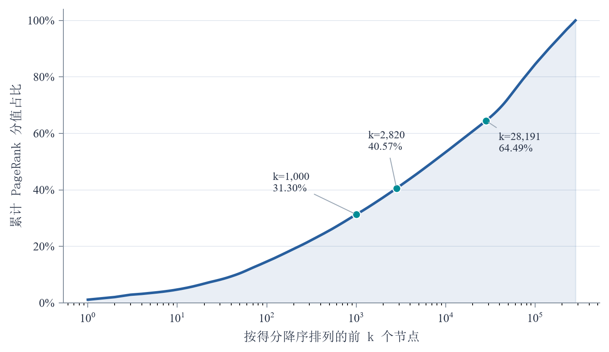

# 基于 TuGraph 的 Stanford Web Graph 分析

中央财经大学 · 专业综合实践  
班级：数据科学与大数据技术23  
张博文　2023312327　任课教师：王卯宁

[查看 PDF 报告](output/pdf/作业报告.pdf) · [查看实验代码](scripts/run_experiment.py) · [返回仓库首页](README.md)

## 摘要

本文以 Stanford Web Graph 为实验数据，在 TuGraph 中构建网页链接图，并开展 PageRank 节点排序和 Node2Vec 节点嵌入实验。数据集包含 281,903 个网页节点和 2,312,497 条有向链接。通过 CSV 批量导入与 Cypher 查询完成图数据建模和规模核验，再基于 TuGraph 导出的边表运行图算法。PageRank 在全图上迭代 100 轮，节点 89073 的得分最高，为 0.01130285。Node2Vec 在以该节点为中心的 1,200 节点子图上学习 32 维向量，训练损失由 2.01132 降至 1.85049，并通过余弦相似度获得结构近邻。通过阻尼系数对比、分值集中度统计和嵌入可视化，进一步分析了网页网络的全局结构与局部关系。

**关键词：** TuGraph；网页链接网络；PageRank；Node2Vec；节点嵌入

## 1 实验目的

本实验基于 TuGraph 平台完成网页链接图的建模与分析。实验包括三个环节：将公开边列表转换为图数据库中的顶点和边；利用 PageRank 计算网页的全局重要性；利用 Node2Vec 学习局部子图的节点向量，并检索结构相近的网页节点。

## 2 实验数据与图模型

### 2.1 数据来源

实验选用 Stanford Network Analysis Project（SNAP）发布的 Stanford Web Graph 数据集[1]。原始文件为 `web-Stanford.txt.gz`，采用边列表格式，每行包含起点和终点两个整数编号。有向边 $(u,v)$ 表示网页 $u$ 包含指向网页 $v$ 的超链接。

数据集包含 281,903 个节点和 2,312,497 条有向边，节点编号范围为 1–281,903。平均出度为

$$
\overline{k}_{\mathrm{out}}=\frac{|E|}{|V|}=\frac{2{,}312{,}497}{281{,}903}\approx 8.20.
$$

### 2.2 TuGraph 图模式

将网页网络表示为有向图 $G=(V,E)$。顶点标签设为 `webpage`，以 INT32 类型的 `id` 属性作为主键；边标签设为 `hyperlink`，起点和终点均为 `webpage` 顶点。原始网页编号保留为主键，边的方向与原始数据一致。图模式及数据规模见表1。

**表 1　图模式与数据规模**

| 项目 | 内容 |
| --- | --- |
| 顶点标签 | `webpage` |
| 顶点主键 | `id`，INT32 类型 |
| 边标签 | `hyperlink` |
| 边方向 | 起点网页指向目标网页 |
| 节点数 | 281,903 |
| 边数 | 2,312,497 |
| 平均出度 | 8.20 |

### 2.3 节点度分布与结构特征

入度反映网页被其他网页链接的次数，出度反映网页包含的外向链接数量。对 TuGraph 导出的全部边分别按终点和起点计数，得到表2所示的统计结果。每条有向边同时贡献一个入度和一个出度，因此全图平均入度与平均出度均为 8.2032。

**表 2　全图入度与出度统计**

| 统计指标 | 入度 | 出度 |
| --- | --- | --- |
| 均值 | 8.2032 | 8.2032 |
| 中位数 | 2 | 5 |
| 90% 分位数 | 10 | 19 |
| 99% 分位数 | 59 | 53 |
| 最大值 | 38,606 | 255 |
| 度数为零的节点数 | 20,315 | 172 |

入度的中位数为 2，而最大值达到 38,606；出度的中位数为 5，最大值为 255。入度分布的尾部明显长于出度分布，说明少数网页接收了大量外部链接。图1采用双对数坐标展示互补累积分布：

$$
F_c(k)=\frac{|\{v\in V:d(v)\ge k\}|}{|V|}.
$$

横轴为度数阈值 $k$，纵轴为度数不小于该阈值的节点比例。入度曲线在高度数区间延伸更远，与最大入度统计相一致。


*图 1　网页节点入度与出度的互补累积分布*

图中共有 172 个零出度节点，在 PageRank 中按悬挂节点处理。20,315 个零入度节点通过随机跳转项和悬挂分值分配项获得得分。这两类节点的统计将网页网络的结构特征与算法中的分值更新规则联系起来。

## 3 数据处理与 TuGraph 建图

### 3.1 数据预处理

预处理程序读取压缩边列表，跳过注释行，提取每条边的起点与终点编号。将全部端点编号合并、去重后写入顶点文件 `webpage.csv`，并将原始有向边写入边文件 `hyperlink.csv`。顶点文件每行保存一个主键，边文件每行保存一对起止主键，两类文件均不含表头。

### 3.2 数据文件与列映射

数据处理阶段通过统一的网页主键连接顶点表与边表。顶点主键由起点集合与终点集合的并集生成，保证每个边端点都能对应到顶点记录。表3列出了输入文件与图模式之间的映射。

**表 3　CSV 数据文件与图模式映射**

| 文件 | 数据列 | 导入用途 |
| --- | --- | --- |
| `webpage.csv` | `id` | 网页顶点及其主键 |
| `hyperlink.csv` | `SRC_ID, DST_ID` | 有向超链接的起点与终点 |
| `import.json` | 模式与文件配置 | 标签、属性类型及端点约束 |

顶点生成和边文件写入的核心代码见代码1。其中，`np.unique` 完成端点去重，边文件沿用原始边的方向。

**代码 1　顶点与边文件生成**

```python
ids = np.unique(np.concatenate((src, dst)))
with (DATA / "webpage.csv").open("w", newline="") as f:
    writer = csv.writer(f, lineterminator="\n")
    writer.writerows((int(v),) for v in ids)
with (DATA / "hyperlink.csv").open("w", newline="") as f:
    writer = csv.writer(f, lineterminator="\n")
    writer.writerows(zip(src.tolist(), dst.tolist()))
```

### 3.3 图数据导入与导出

根据 TuGraph 的批量导入格式[3]编写 `import.json`，配置顶点标签、主键、边标签、端点约束及 CSV 列映射。通过 `lgraph_import` 将数据导入 `default` 图，核心命令见代码2。

**代码 2　TuGraph 批量导入命令**

```bash
lgraph_import -c /workspace/import.json \
  --dir /workspace/tugraph_db \
  --graph default --overwrite 1
```

导入完成后，使用 `lgraph_export` 导出图数据。PageRank 和 Node2Vec 均读取导出的 `tugraph_export/hyperlink_webpage_webpage.csv`，以导入数据库后的图作为算法输入。

### 3.4 图规模核验

在 TuGraph 中执行代码3所示的 Cypher 查询，分别统计网页节点和超链接数量。查询结果为 281,903 个节点、2,312,497 条边，与预处理统计一致。

**代码 3　节点与边数量查询**

```cypher
MATCH (p:webpage) RETURN count(p);
MATCH ()-[e:hyperlink]->() RETURN count(e);
```

## 4 算法原理与实验方法

### 4.1 PageRank 节点重要性计算

PageRank 根据链接关系递归计算节点重要性。节点从入邻居接收分值，分配比例由入邻居的出度确定。实验采用阻尼系数 $\alpha=0.85$，迭代更新式为

$$
PR_{t+1}(v)=\frac{1-\alpha}{N}+\alpha\left(\sum_{u\in In(v)}\frac{PR_t(u)}{k_{\mathrm{out}}(u)}+\frac{D_t}{N}\right),
$$

其中，$N$ 为节点数，$In(v)$ 为指向节点 $v$ 的节点集合，$k_{\mathrm{out}}(u)$ 为节点 $u$ 的出度，$D_t$ 为第 $t$ 轮中出度为零的节点分值之和。

程序使用 SciPy 稀疏矩阵保存转移概率，将每个节点的初始得分设为 $1/N$。每轮迭代按式(3)传播分值，并将悬挂节点的分值均匀分配至全体节点。最大迭代次数设为 100，停止阈值设为 $10^{-12}$。相邻两轮得分差的 $L_1$ 范数定义为

$$
\varepsilon_t=\sum_{v\in V}|PR_{t+1}(v)-PR_t(v)|.
$$

### 4.2 PageRank 的稀疏矩阵实现

设 $P_{vu}$ 表示从节点 $u$ 到节点 $v$ 的转移概率。程序将边的终点编号作为矩阵行索引，将起点编号作为列索引；每条边的权重为起点出度的倒数。由此构造的矩阵按列分配节点分值，矩阵向量乘积 $P\mathbf{r}_t$ 对应一次链接传播。

代码4给出矩阵构建与迭代计算的主要步骤。COO 格式用于根据边列表构造矩阵，CSR 格式用于反复执行稀疏矩阵向量乘法。

**代码 4　PageRank 稀疏矩阵计算**

```python
outdeg = np.bincount(src_idx, minlength=n).astype(float)
weights = 1.0 / outdeg[src_idx]
transition = coo_matrix(
    (weights, (dst_idx, src_idx)), shape=(n, n)
).tocsr()
rank = np.full(n, 1.0 / n)
dangling = outdeg == 0
for it in range(1, max_iter + 1):
    new = alpha * (
        transition @ rank + rank[dangling].sum() / n
    ) + (1.0 - alpha) / n
    err = float(np.abs(new - rank).sum())
    rank = new
    if err < tol:
        break
```

每轮计算由稀疏矩阵向量乘法和节点分值归约组成，时间复杂度为 $O(|V|+|E|)$；运行 $T$ 轮的总复杂度为 $O(T(|V|+|E|))$。稀疏表示按非零边关系存储转移概率，适用于本实验中节点数较大、平均出度为 8.20 的网页图。

### 4.3 Node2Vec 节点嵌入

Node2Vec 通过带偏置的随机游走生成节点序列，再利用 Skip-gram 学习节点向量[2]。本实验以 PageRank 排名第一的节点 89073 为中心，按无向邻接关系执行广度优先搜索，选择 1,200 个节点。遍历时对邻居编号排序；随后保留选中节点之间的原始有向边，得到包含 2,289 条边的诱导子图。

随机游走沿子图的出边前进。设上一节点为 $t$、当前节点为 $v$、候选下一节点为 $x$，程序根据出边邻接关系计算偏置权重：

$$
\eta_{pq}(t,x)=
\begin{cases}
1/p, & x=t,\\
1, & x\ne t\ \text{且}\ x\in N_{\mathrm{out}}(t),\\
1/q, & \text{其他情况}.
\end{cases}
$$

对 $N_{\mathrm{out}}(v)$ 中各候选节点的权重归一化后，得到下一步的采样概率。本实验设 $p=1$、$q=2$，每个节点生成 4 条游走，每条最多包含 12 个节点；遇到无出边节点时结束该条游走。

### 4.4 向量训练与相似度计算

Skip-gram 从游走序列中构造中心节点与窗口上下文节点的正样本对，并通过负采样训练输入向量与输出向量。单个正样本对 $(v,u)$ 的优化目标为

$$
\log\sigma(\mathbf{z}_v^{\mathsf T}\mathbf{c}_u)+\sum_{i=1}^{K}\mathbb{E}_{n_i\sim P_n}\log\sigma(-\mathbf{z}_v^{\mathsf T}\mathbf{c}_{n_i}),
$$

其中，$\mathbf{z}_v$ 为输入向量，$\mathbf{c}_u$ 为输出向量，$\sigma$ 为 Sigmoid 函数，$K$ 为负样本数。程序将节点频率计数初始化为 1，累计游走中的出现次数，再取 $0.75$ 次幂并归一化，得到负采样分布 $P_n$。

实验设置嵌入维数为 32、窗口大小为 3、负样本数为 3，训练 5 轮。随机种子为 20261022，5 轮训练的学习率依次为 0.025、0.020、0.015、0.010 和 0.005。主要参数见表4。

**表 4　Node2Vec 实验参数**

| 参数 | 取值 | 参数 | 取值 |
| --- | --- | --- | --- |
| 采样中心节点 | 89073 | 样本节点数 | 1,200 |
| 每节点游走数 | 4 | 最大游走长度 | 12 |
| 回访参数 $p$ | 1 | 探索参数 $q$ | 2 |
| 嵌入维数 | 32 | 窗口大小 | 3 |
| 负样本数 | 3 | 训练轮数 | 5 |

### 4.5 训练样本构造与参数更新

窗口大小为 3 时，每个中心节点与前后最多 3 个节点组成正样本对。对一条长度为 $L$ 的游走序列，窗口内距离为 $d$ 的节点对按两个方向计数，因此正样本对数为

$$
C(L,w)=2\sum_{d=1}^{\min(w,L-1)}(L-d).
$$

本次生成的 4,800 条游走序列长度均为 12。当 $L=12$、$w=3$ 时，每条序列产生

$$
C(12,3)=2(11+10+9)=60
$$

个正样本对，全部序列合计为 $4{,}800\times60=288{,}000$ 对。窗口截取的实现见代码5。

**代码 5　Skip-gram 正样本对构造**

```python
pairs = []
for walk in token_walks:
    for i, center in enumerate(walk):
        lo = max(0, i - window)
        hi = min(len(walk), i + window + 1)
        for j in range(lo, hi):
            if j != i:
                pairs.append((center, walk[j]))
```

对每个正样本对，程序同时抽取 3 个负样本。每轮训练包含 288,000 个正样本项和 864,000 个负样本项，共进行 1,152,000 次二元目标更新；5 轮合计 5,760,000 次。设样本标签为 $y$、学习率为 $\gamma$，梯度系数为

$$
g=\gamma\left(y-\sigma(\mathbf{z}_v^{\mathsf T}\mathbf{c}_u)\right).
$$

输入向量与输出向量分别沿梯度方向更新，核心代码如下。

**代码 6　负采样梯度更新**

```python
old = out_vec[target].copy()
prob = sigmoid(float(np.dot(v, old)))
grad = (label - prob) * rate
in_vec[center] += grad * old
out_vec[target] += grad * v
```

训练损失按正样本对数量归一化，每个正样本对的损失由 1 个正样本项与 3 个负样本项共同组成。

训练完成后，使用节点的输入向量计算余弦相似度：

$$
\operatorname{sim}(u,v)=\frac{\mathbf{z}_u^{\mathsf T}\mathbf{z}_v}{\|\mathbf{z}_u\|_2\|\mathbf{z}_v\|_2}.
$$

以节点 89073 为查询节点，将其与其余样本节点的相似度降序排列，得到嵌入近邻。

### 4.6 实验对比与嵌入可视化方法

PageRank 对比实验选取阻尼系数 0.75、0.85 和 0.95，各组均采用均匀初值、100 轮上限及 $10^{-12}$ 的停止阈值。记录每轮 $L_1$ 残差、最终排序和最高得分，并统计各组前十名节点与基准组 $\alpha=0.85$ 的重合数量。

为展示节点向量的整体结构，对 $1{,}200\times32$ 的嵌入矩阵 $Z$ 进行按列中心化，得到 $X$，再执行奇异值分解：

$$
X=U\Sigma V^{\mathsf T}.
$$

取前两个右奇异向量构成 $V_2$，以 $XV_2$ 作为二维投影坐标。第 $i$ 个主成分的方差解释率为

$$
\rho_i=\frac{\sigma_i^2}{\sum_j\sigma_j^2}.
$$

投影图以颜色表示节点与查询节点的余弦相似度，以星形标记查询节点，以空心圆标记前十名近邻。同时计算查询节点及十个近邻之间的余弦相似度矩阵，使用热力图展示局部节点群体的关系。

## 5 实验结果与分析

### 5.1 PageRank 排序结果

PageRank 在全图上迭代 100 轮，按最大迭代次数停止。最终 $L_1$ 残差为 $1.9371\times10^{-9}$，节点得分之和为 1.000000。得分前十的节点及其出度见表5，对应分布见图2。

**表 5　PageRank 得分前十的节点**

| 排名 | 节点编号 | PageRank | 出度 |
| --- | --- | --- | --- |
| 1 | 89073 | 0.01130285 | 64 |
| 2 | 226411 | 0.00926783 | 20 |
| 3 | 241454 | 0.00829727 | 64 |
| 4 | 262860 | 0.00302312 | 1 |
| 5 | 134832 | 0.00300128 | 7 |
| 6 | 234704 | 0.00257173 | 23 |
| 7 | 136821 | 0.00245371 | 14 |
| 8 | 68889 | 0.00243079 | 12 |
| 9 | 105607 | 0.00239105 | 35 |
| 10 | 69358 | 0.00236401 | 7 |

节点 89073 的 PageRank 最高，为 0.01130285，约为第二名的 1.22 倍。前三名分值合计为 0.02887，占总分值的 2.89%；前十名合计为 0.04710，占总分值的 4.71%。第三名得分约为第四名的 2.74 倍，前三名与其后节点形成明显差距。


*图 2　PageRank 得分前十的节点*

图3给出了全图 PageRank 得分的对数直方图。低分区间集中分布着大量节点，高分区间的节点数量逐渐减少，形成长尾分布。该结果与前十名节点占有较高分值的排序结果一致，表明网页链接网络中的重要性集中于少数节点。


*图 3　全图 PageRank 得分分布*

### 5.2 阻尼系数与迭代过程对比

表6给出了不同阻尼系数的计算结果。$\alpha=0.75$ 在第 84 轮达到停止阈值，最终残差为 $7.49\times10^{-13}$；$\alpha=0.85$ 和 $\alpha=0.95$ 均运行至第 100 轮，最终残差分别为 $1.94\times10^{-9}$ 和 $1.31\times10^{-4}$。

**表 6　阻尼系数对比实验结果（最多 100 轮）**

| $\alpha$ | 轮次 | 最终残差 | 第一名节点 | 第一名得分 | 前十名重合数 |
| --- | --- | --- | --- | --- | --- |
| 0.75 | 84 | $7.49\times10^{-13}$ | 226411 | 0.00981308 | 6 |
| 0.85 | 100 | $1.94\times10^{-9}$ | 89073 | 0.01130285 | 10 |
| 0.95 | 100 | $1.31\times10^{-4}$ | 89073 | 0.01246608 | 6 |

 表中前十名重合数以 $\alpha=0.85$ 为基准。

图4显示，三组残差均随迭代持续下降。较小的阻尼系数对应更快的残差下降速度；较大的阻尼系数提高了链接传播项的权重，使网络中的循环链接关系在更多轮次中继续传递分值。


*图 4　不同阻尼系数下的 PageRank 迭代残差*

阻尼系数也改变了头部节点的相对得分。$\alpha=0.75$ 时，节点 226411 排名第一；$\alpha=0.85$ 与 $\alpha=0.95$ 时，节点 89073 排名第一。两个对比组与基准组的前十名均重合 6 个节点，Jaccard 系数均为

$$
J=\frac{|A\cap B|}{|A\cup B|}=\frac{6}{14}\approx0.4286.
$$

这些结果反映了阻尼系数对随机跳转与链接传播两部分权重的调节作用。

### 5.3 PageRank 分值集中度

将节点按 PageRank 得分降序排列，累计前 $k$ 个节点的分值：

$$
S(k)=\sum_{i=1}^{k}PR_{(i)}.
$$

表7给出了不同排名区间的累计结果。前 1,000 个节点仅占全部节点的 0.3547%，累计分值已达到 31.30%；前 2,820 个节点约占节点总数的 1%，累计分值达到 40.57%。

**表 7　PageRank 分值集中度**

| 前 $k$ 个节点 | 节点数量占比 | 累计 PageRank 分值 |
| --- | --- | --- |
| 100 | 0.0355% | 14.62% |
| 1,000 | 0.3547% | 31.30% |
| 2,820 | 1.0003% | 40.57% |
| 14,096 | 5.0003% | 57.05% |
| 28,191 | 10.0002% | 64.49% |

图5以对数横轴展示累计曲线，使头部节点和长尾节点在同一图中得到清晰呈现。前约 10% 的节点累计取得 64.49% 的分值，说明该网页图的链接重要性具有显著的集中分布特征。



*图 5　排名前 $k$ 个节点的累计 PageRank 分值*

### 5.4 Node2Vec 训练结果

局部子图包含 1,200 个节点和 2,289 条有向边，共生成 4,800 条随机游走序列，构造 288,000 个 Skip-gram 正样本对。第 1 轮平均负采样损失为 2.01132，第 5 轮降至 1.85049，相对下降约 8.00%。训练统计见表8。

**表 8　Node2Vec 训练统计**

| 指标 | 数值 |
| --- | --- |
| 样本节点数 | 1,200 |
| 样本有向边数 | 2,289 |
| 游走序列数 | 4,800 |
| 正样本对数 | 288,000 |
| 第 1 轮平均负采样损失 | 2.01132 |
| 第 5 轮平均负采样损失 | 1.85049 |
| 损失相对下降 | 8.00% |

### 5.5 节点嵌入近邻分析

表9列出了与中心节点 89073 余弦相似度最高的十个样本节点。节点 16518 的相似度最高，为 0.91369；前五名的相似度介于 0.89990 与 0.91369 之间。这些节点在随机游走序列中具有相近的上下文，因而在向量空间中表现出较高的结构相似度。

**表 9　节点 89073 的嵌入近邻**

| 排名 | 节点编号 | 余弦相似度 |
| --- | --- | --- |
| 1 | 16518 | 0.91369 |
| 2 | 19912 | 0.90640 |
| 3 | 12055 | 0.90587 |
| 4 | 9082 | 0.90515 |
| 5 | 7815 | 0.89990 |
| 6 | 20040 | 0.89738 |
| 7 | 8209 | 0.89480 |
| 8 | 18910 | 0.89331 |
| 9 | 2748 | 0.89174 |
| 10 | 5237 | 0.89118 |

PageRank 与 Node2Vec 分别给出节点的排序结果和向量表示。前者在完整图上累计链接贡献，得到网页的全局重要性；后者在局部子图上学习游走上下文，得到可用于近邻检索的节点表示。两项结果分别对应全局节点排序与局部结构关系分析。

### 5.6 节点嵌入的二维投影

主成分分析得到，第一主成分解释 46.19% 的向量方差，第二主成分解释 20.58%，累计解释率为 66.77%。图6展示全部 1,200 个节点的二维位置，并用连续色阶表示与节点 89073 的余弦相似度。


*图 6　Node2Vec 嵌入的主成分投影*

节点在投影空间中主要沿第一主成分展开，查询节点及部分节点在第二主成分方向具有较明显的偏移。PCA 坐标描述中心化向量的方差结构，近邻排序则采用 32 维向量之间的夹角；两种表示分别展示整体变化和方向相似关系。全部候选节点与查询节点的余弦相似度中位数为 0.76828，90% 分位数为 0.85712；前十名近邻的相似度均超过 0.891。

### 5.7 近邻节点群体的相似度结构

图7展示查询节点和前十名近邻之间的余弦相似度矩阵。首行和首列对应查询节点 89073，其与十个近邻的相似度为 0.89118–0.91369。其余十个节点之间的非对角相似度平均值为 0.96518，最小值为 0.92913。


*图 7　查询节点及前十名近邻的余弦相似度矩阵（星号表示查询节点）*

近邻节点之间形成了整体相似度较高的群体，说明这些节点在游走上下文中具有一致的结构特征。相似度热力图将单个查询节点的排序结果扩展为节点群体之间的关系展示，与前十名近邻表共同构成嵌入分析结果。

## 6 综合分析

### 6.1 全局排序与局部表示的关系

表10归纳了两种算法在本实验中的输入、计算和输出。PageRank 使用完整链接网络迭代传播分值，Node2Vec 使用局部诱导子图的游走序列优化节点向量，两项算法分别形成一维排序分数和多维结构表示。

**表 10　两项图算法的实验比较**

| 比较项目 | PageRank | Node2Vec |
| --- | --- | --- |
| 计算范围 | 281,903 节点的完整图 | 1,200 节点的局部子图 |
| 主要输入 | 有向边与节点出度 | 随机游走与窗口样本对 |
| 计算方式 | 概率分值迭代 | Skip-gram 负采样训练 |
| 输出结果 | 每节点一个重要性分数 | 每节点一个 32 维向量 |
| 结果组织 | 全图重要性排序 | 余弦近邻与相似度矩阵 |

节点出度与 PageRank 排名呈现不同的统计关系。例如，节点 262860 的出度为 1，PageRank 排名第四；节点 225872 的出度为 189，PageRank 排名第十二。PageRank 通过入链及其来源节点的重要性累计分值，单个节点的外链数量则描述其链接行为。全图 $\log(1+k_{\mathrm{in}})$ 与 $\log(PR)$ 的 Pearson 相关系数为 0.5640，表明链接数量与递归分值之间存在明确关联，同时保留了来源节点权重带来的排序差异。

### 6.2 从图存储到分析结果的数据链

实验以同一份网页编号贯穿数据准备、TuGraph 存储、图导出和算法计算。节点数量与边数量通过 Cypher 查询核验；PageRank 结果以网页编号回写排名文件；Node2Vec 向量和近邻同样沿用原始编号。由此，图查询记录、排序结果、节点向量和图表能够按编号对应。

度分布、阻尼系数对比和向量投影均由实验边表或节点嵌入文件计算得到。中间结果与统计文件见表11，文件统一存放于 `results/` 目录。完整代码与结果可通过[GitHub 实验仓库](https://github.com/MuonChaser/tugraph-homework-2)获取。

**表 11　扩展分析的中间结果文件**

| 文件 | 内容 |
| --- | --- |
| pagerank_iterations.csv | 各组逐轮迭代残差 |
| pagerank_concentration.csv | 排名区间累计分值 |
| pagerank_full.csv.gz | 全图节点度数及 PageRank |
| node2vec_projection.csv | 二维投影坐标及查询相似度 |
| node2vec_neighbor_heatmap.csv | 近邻节点相似度矩阵 |
| extended_analysis.json | 结构统计与对比结果摘要 |

## 7 实验总结

本实验完成了 Stanford Web Graph 的预处理、TuGraph 图模式构建、批量导入及查询核验，建立了包含 281,903 个节点和 2,312,497 条有向边的网页链接图。在此基础上，使用 PageRank 获得全图节点重要性排序，其中节点 89073 排名第一；使用 Node2Vec 在 1,200 节点子图上学习 32 维向量，并通过余弦相似度检索结构近邻。进一步的统计表明，前约 1% 的节点占据全图 PageRank 分值的 40.57%，阻尼系数改变了迭代速度和头部排序；节点嵌入的前两个主成分累计解释 66.77% 的方差，前十名近邻之间的平均余弦相似度达到 0.96518。实验将图数据库的数据管理功能与节点排序、节点表示学习结合，完成了从图数据建模到算法分析的实验流程。

## 参考文献

1. Stanford Network Analysis Project. [Stanford web graph](https://snap.stanford.edu/data/web-Stanford.html).
2. Grover A, Leskovec J. node2vec: Scalable Feature Learning for Networks. KDD, 2016.
3. [TuGraph 官方文档](https://tugraph-db.readthedocs.io/).
4. Hu Xueyan. [CUFE Course Report LaTeX Template](https://www.overleaf.com/latex/templates/central-university-of-finance-and-economics-cufe-course-report-latex-template/zjsmnqbwgmyg). Overleaf. CC BY 4.0.
