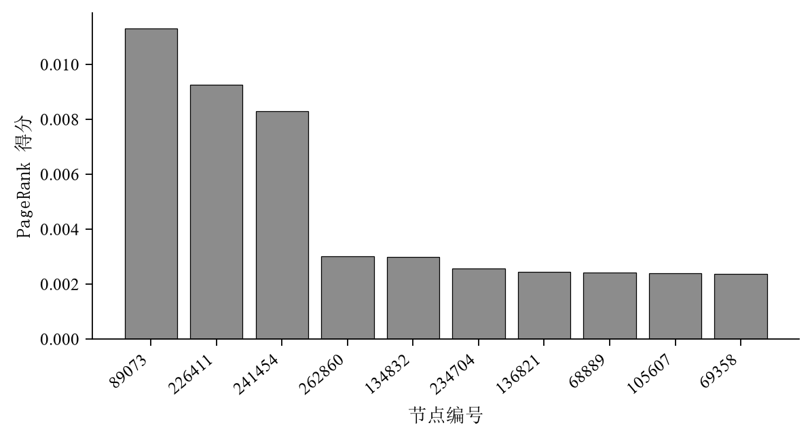
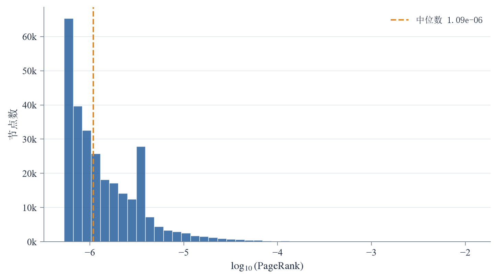

# 基于 TuGraph 的 Stanford Web Graph 分析

中央财经大学 · 专业综合实践  
班级：数据科学与大数据技术23  
张博文　2023312327　任课教师：王卯宁

[查看 PDF 报告](output/pdf/作业报告.pdf) · [查看完整算法代码](scripts/run_experiment.py) · [返回仓库首页](README.md)

## 摘要

本文以 Stanford Web Graph 为实验数据，在 TuGraph 中构建网页链接图，并开展 PageRank 节点排序和 Node2Vec 节点嵌入实验。数据集包含 281,903 个网页节点和 2,312,497 条有向链接。通过 CSV 批量导入与 Cypher 查询完成图数据建模和规模核验，再基于 TuGraph 导出的边表运行图算法。PageRank 在全图上迭代 100 轮，节点 89073 的得分最高，为 0.01130285。Node2Vec 在以该节点为中心的 1,200 节点子图上学习 32 维向量，训练损失由 2.01132 降至 1.85049，并通过余弦相似度获得结构近邻。实验实现了图数据存储、查询、节点重要性排序和节点表示学习的完整流程。

**关键词：** TuGraph；网页链接网络；PageRank；Node2Vec；节点嵌入

## 1 实验目的

基于 TuGraph 完成网页链接图的建模与分析，将公开边列表转换为图数据库中的顶点和边；利用 PageRank 计算网页的全局重要性；利用 Node2Vec 学习局部子图的节点向量，并检索结构相近的网页节点。

## 2 实验数据与图模型

实验选用 [SNAP Stanford Web Graph](https://snap.stanford.edu/data/web-Stanford.html)。原始文件为 `web-Stanford.txt.gz`，每行包含起点和终点两个整数编号。有向边 $(u,v)$ 表示网页 $u$ 包含指向网页 $v$ 的超链接。

在 TuGraph 中，顶点标签设为 `webpage`，以 INT32 类型的 `id` 作为主键；边标签设为 `hyperlink`，起点和终点均为 `webpage`。原始编号与链接方向保留不变。

| 项目 | 内容 |
| --- | --- |
| 顶点标签 | `webpage` |
| 顶点主键 | `id`，INT32 |
| 边标签 | `hyperlink` |
| 节点数 | 281,903 |
| 有向边数 | 2,312,497 |
| 节点编号范围 | 1–281,903 |
| 平均出度 | 8.20 |

平均出度为：

$$
\overline{k}_{\mathrm{out}}=\frac{|E|}{|V|}
=\frac{2{,}312{,}497}{281{,}903}\approx 8.20.
$$

## 3 数据处理与 TuGraph 建图

### 3.1 数据预处理

预处理程序读取压缩边列表，跳过注释行，提取每条边的起点与终点。将全部端点编号合并、去重后写入 `webpage.csv`，并将原始有向边写入 `hyperlink.csv`。顶点文件每行保存一个主键，边文件每行保存一对起止主键，两类文件均不含表头。

[数据下载脚本](scripts/download_data.py) · [数据预处理代码](scripts/run_experiment.py) · [预处理统计](results/dataset_stats.json)

### 3.2 图数据导入与导出

通过 [import.json](import.json) 配置顶点标签、主键、边标签、端点约束和 CSV 列映射。使用 `lgraph_import` 将数据导入 `default` 图：

```bash
lgraph_import -c /workspace/import.json \
  --dir /workspace/tugraph_db \
  --graph default --overwrite 1
```

导入完成后，使用 `lgraph_export` 导出图数据。两项算法均读取 `tugraph_export/hyperlink_webpage_webpage.csv`，以导入数据库后的图作为算法输入。完整 Docker 命令见 [运行方法](README.md#运行方法)。

### 3.3 图规模核验

在 TuGraph 中执行节点与边数量查询：

```cypher
MATCH (p:webpage) RETURN count(p);
MATCH ()-[e:hyperlink]->() RETURN count(e);
```

查询结果如下：

| 查询对象 | 数量 |
| --- | ---: |
| `webpage` 节点 | 281,903 |
| `hyperlink` 边 | 2,312,497 |

查询结果与预处理统计一致。[图规模核验记录](results/tugraph_verification.json)由 [verify_tugraph.py](scripts/verify_tugraph.py) 通过 TuGraph REST API 获取。

## 4 算法原理与实验方法

### 4.1 PageRank

PageRank 根据链接关系递归计算节点重要性。节点从入邻居接收分值，分配比例由入邻居的出度确定。阻尼系数设为 $\alpha=0.85$，更新式为：

$$
PR_{t+1}(v)=\frac{1-\alpha}{N}+
\alpha\left(
\sum_{u\in In(v)}\frac{PR_t(u)}{k_{\mathrm{out}}(u)}
+\frac{D_t}{N}
\right).
$$

其中，$N$ 为节点数，$In(v)$ 为节点 $v$ 的入邻居集合，$k_{\mathrm{out}}(u)$ 为节点 $u$ 的出度，$D_t$ 为悬挂节点分值之和。

程序使用 SciPy 稀疏矩阵保存转移概率。每个节点的初始得分为 $1/N$，最大迭代次数为 100，$L_1$ 停止阈值为 $10^{-12}$。核心迭代代码如下：

```python
for it in range(1, max_iter + 1):
    new = alpha * (
        transition @ rank + rank[dangling].sum() / n
    ) + (1.0 - alpha) / n
    err = float(np.abs(new - rank).sum())
    rank = new
    if err < tol:
        break
```

### 4.2 Node2Vec

以 PageRank 排名第一的节点 89073 为中心，按无向邻接关系执行广度优先搜索，选择 1,200 个节点。遍历时对邻居编号排序，再保留选中节点之间的原始有向边，得到包含 2,289 条边的诱导子图。

随机游走沿子图出边进行。设上一节点为 $t$、当前节点为 $v$、候选下一节点为 $x$，转移偏置按以下规则计算：

$$
\eta_{pq}(t,x)=
\begin{cases}
1/p,&x=t,\\
1,&x\ne t\ \text{且}\ x\in N_{\mathrm{out}}(t),\\
1/q,&\text{其他情况}.
\end{cases}
$$

将当前节点出邻居的权重归一化后，得到下一步的采样概率。核心采样代码如下：

```python
weights = [
    1.0 / p if v == prev
    else (1.0 if v in out_sets[prev] else 1.0 / q)
    for v in choices
]
nxt = rng.choices(choices, weights=weights, k=1)[0]
```

| 参数 | 取值 |
| --- | ---: |
| 采样中心节点 | 89073 |
| 样本节点数 | 1,200 |
| 每节点游走数 | 4 |
| 最大游走长度 | 12 |
| 回访参数 $p$ | 1 |
| 探索参数 $q$ | 2 |
| 嵌入维数 | 32 |
| 窗口大小 | 3 |
| 负样本数 | 3 |
| 训练轮数 | 5 |
| 随机种子 | 20261022 |
| 初始学习率 | 0.025 |

Skip-gram 从游走序列构造中心节点与窗口上下文的正样本对，并通过负采样训练输入向量与输出向量。单个正样本对 $(v,u)$ 的优化目标为：

$$
\log\sigma(\mathbf{z}_v^{\mathsf T}\mathbf{c}_u)
+\sum_{i=1}^{K}
\mathbb{E}_{n_i\sim P_n}
\log\sigma(-\mathbf{z}_v^{\mathsf T}\mathbf{c}_{n_i}).
$$

负采样分布由节点在游走序列中的频率取 $0.75$ 次幂后归一化得到。训练完成后，使用输入向量的余弦相似度检索近邻：

$$
\operatorname{sim}(u,v)=
\frac{\mathbf{z}_u^{\mathsf T}\mathbf{z}_v}
{\|\mathbf{z}_u\|_2\|\mathbf{z}_v\|_2}.
$$

## 5 实验结果与分析

### 5.1 PageRank 排序

PageRank 在全图上迭代 100 轮，按最大迭代次数停止。最终 $L_1$ 残差为 $1.9371\times10^{-9}$，节点得分之和为 1.000000。

| 排名 | 节点编号 | PageRank | 出度 |
| ---: | ---: | ---: | ---: |
| 1 | 89073 | 0.01130285 | 64 |
| 2 | 226411 | 0.00926783 | 20 |
| 3 | 241454 | 0.00829727 | 64 |
| 4 | 262860 | 0.00302312 | 1 |
| 5 | 134832 | 0.00300128 | 7 |
| 6 | 234704 | 0.00257173 | 23 |
| 7 | 136821 | 0.00245371 | 14 |
| 8 | 68889 | 0.00243079 | 12 |
| 9 | 105607 | 0.00239105 | 35 |
| 10 | 69358 | 0.00236401 | 7 |



节点 89073 的 PageRank 最高，约为第二名的 1.22 倍。前三名分值合计为 0.02887，占总分值的 2.89%；前十名合计为 0.04710，占总分值的 4.71%。第三名得分约为第四名的 2.74 倍，前三名与其后节点形成明显差距。



全图得分的对数直方图显示，低分区间集中分布着大量节点，高分区间的节点数量逐渐减少，形成长尾分布。该结果与前十名节点占有较高分值的排序结果一致，表明网页链接网络中的重要性集中于少数节点。

[PageRank 前二十名 CSV](results/pagerank_top20.csv) · [完整 PageRank 指标](results/pagerank_summary.json)

### 5.2 Node2Vec 训练结果

| 指标 | 数值 |
| --- | ---: |
| 样本节点数 | 1,200 |
| 样本有向边数 | 2,289 |
| 游走序列数 | 4,800 |
| 正样本对数 | 288,000 |
| 第 1 轮平均负采样损失 | 2.01132 |
| 第 5 轮平均负采样损失 | 1.85049 |
| 损失相对下降 | 8.00% |

共生成 4,800 条随机游走序列和 288,000 个 Skip-gram 正样本对。经过 5 轮训练，平均负采样损失由 2.01132 降至 1.85049，相对下降约 8.00%。

### 5.3 嵌入近邻分析

| 排名 | 节点编号 | 与节点 89073 的余弦相似度 |
| ---: | ---: | ---: |
| 1 | 16518 | 0.91369 |
| 2 | 19912 | 0.90640 |
| 3 | 12055 | 0.90587 |
| 4 | 9082 | 0.90515 |
| 5 | 7815 | 0.89990 |
| 6 | 20040 | 0.89738 |
| 7 | 8209 | 0.89480 |
| 8 | 18910 | 0.89331 |
| 9 | 2748 | 0.89174 |
| 10 | 5237 | 0.89118 |

节点 16518 的相似度最高，为 0.91369；前五名相似度介于 0.89990 与 0.91369 之间。这些节点在随机游走序列中具有相近的上下文，因而在向量空间中表现出较高的结构相似度。

PageRank 在完整图上累计链接贡献，得到网页的全局重要性；Node2Vec 在局部子图上学习游走上下文，得到可用于近邻检索的节点表示。两项结果分别对应全局节点排序与局部结构关系分析。

[近邻结果 CSV](results/node2vec_nearest_pages.csv) · [32 维节点向量 CSV](results/node2vec_embeddings_sample.csv) · [完整 Node2Vec 指标](results/node2vec_summary.json)

## 6 实验总结

本实验完成了 Stanford Web Graph 的预处理、TuGraph 图模式构建、批量导入及查询核验，建立了包含 281,903 个节点和 2,312,497 条有向边的网页链接图。在此基础上，使用 PageRank 获得全图节点重要性排序，其中节点 89073 排名第一；使用 Node2Vec 在 1,200 节点子图上学习 32 维向量，并通过余弦相似度检索结构近邻。实验将图数据库的数据管理功能与节点排序、节点表示学习结合，完成了从图数据建模到算法分析的实验流程。

## 参考文献

1. Stanford Network Analysis Project. [Stanford web graph](https://snap.stanford.edu/data/web-Stanford.html).
2. Grover A, Leskovec J. node2vec: Scalable Feature Learning for Networks. KDD, 2016.
3. [TuGraph 官方文档](https://tugraph-db.readthedocs.io/).
4. Hu Xueyan. [CUFE Course Report LaTeX Template](https://www.overleaf.com/latex/templates/central-university-of-finance-and-economics-cufe-course-report-latex-template/zjsmnqbwgmyg). Overleaf. CC BY 4.0.


